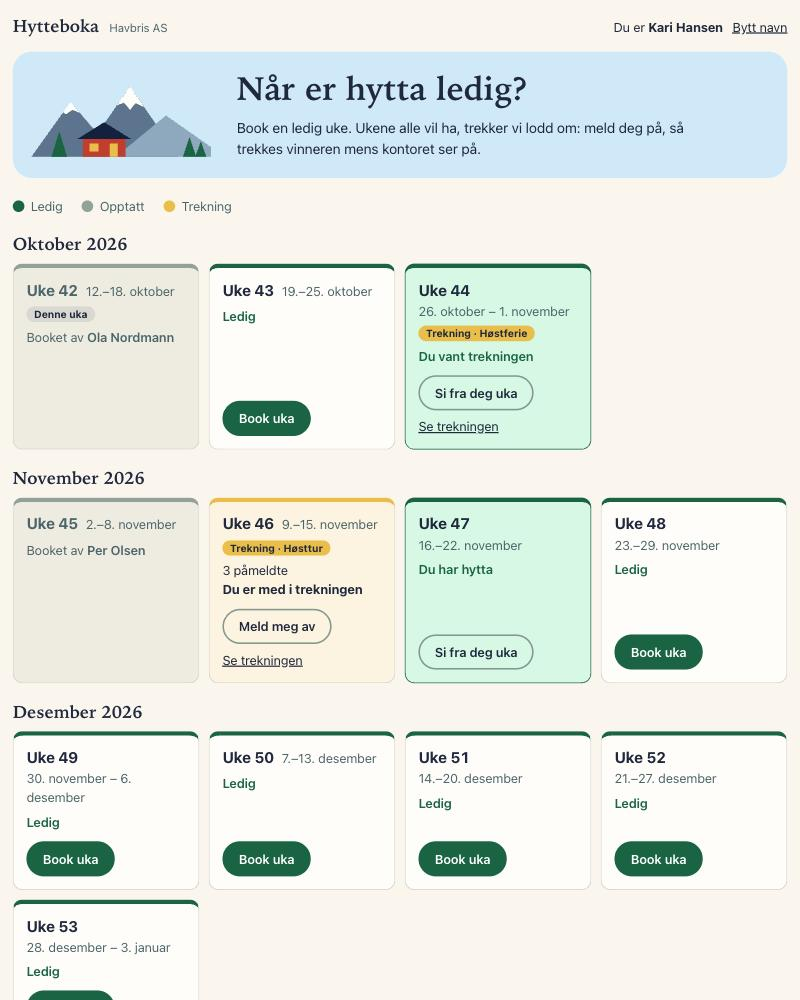
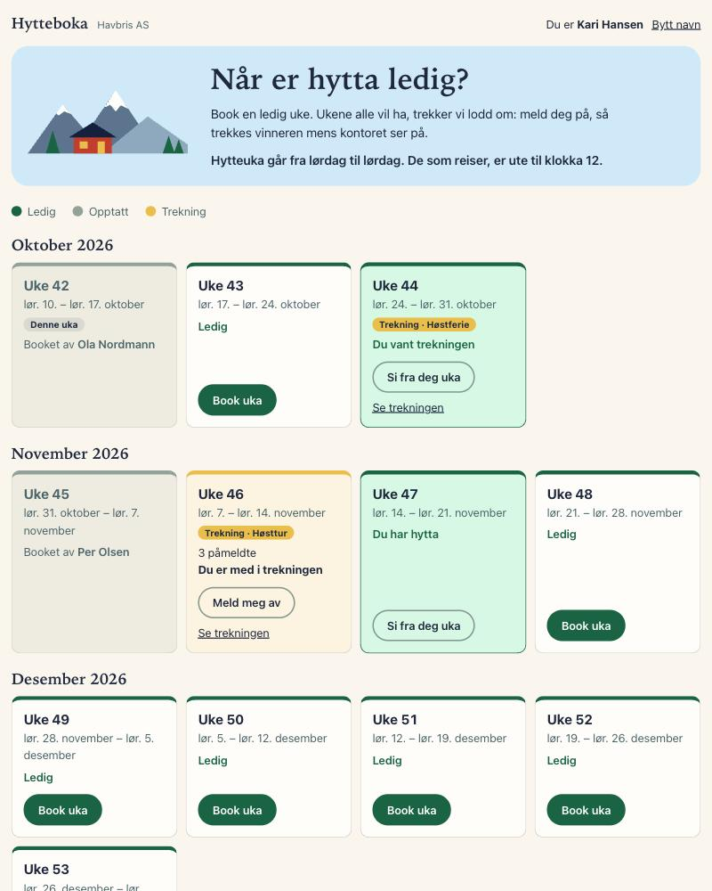
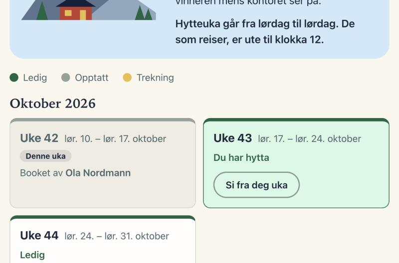
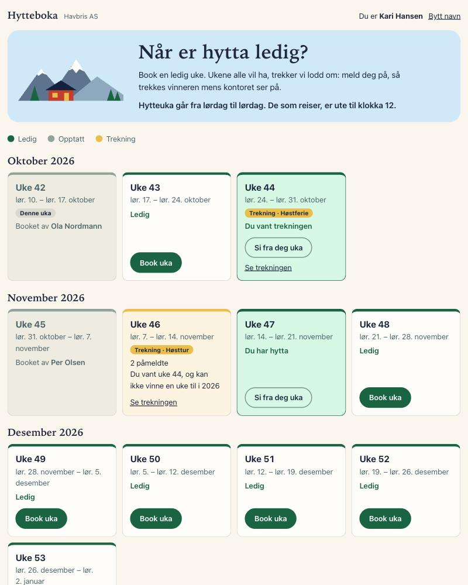
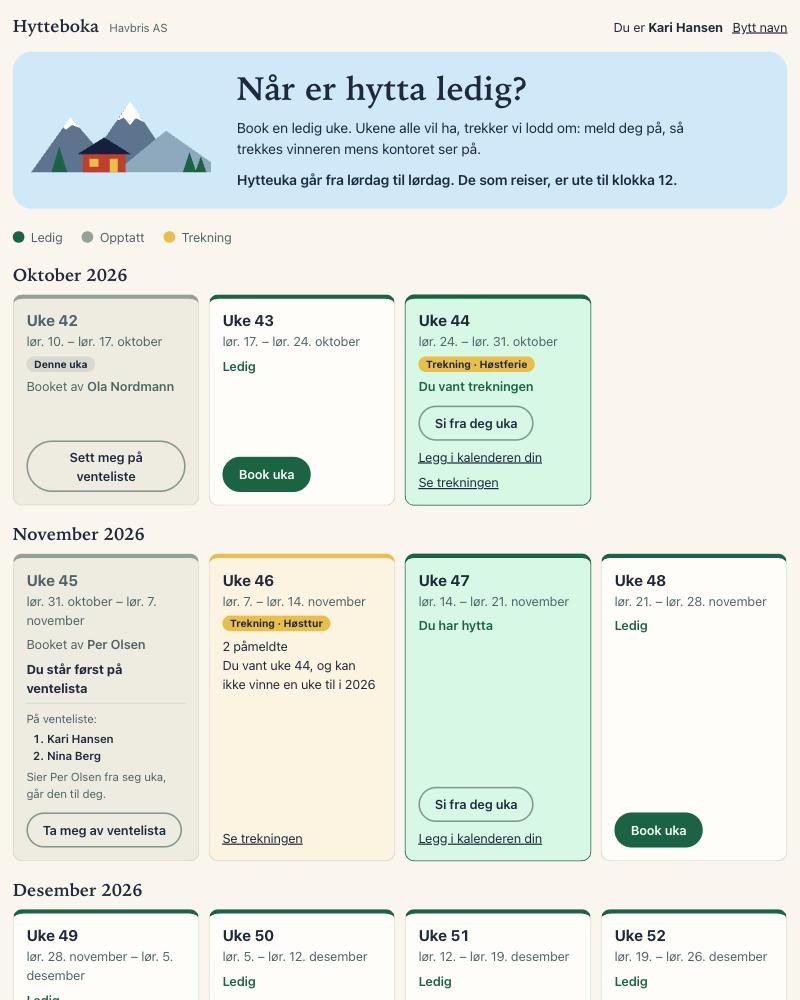
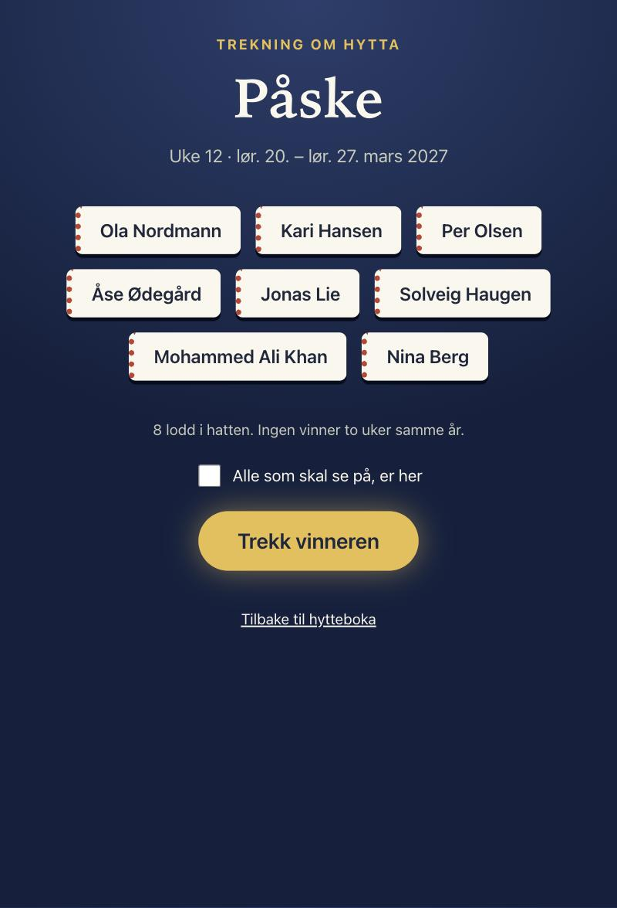
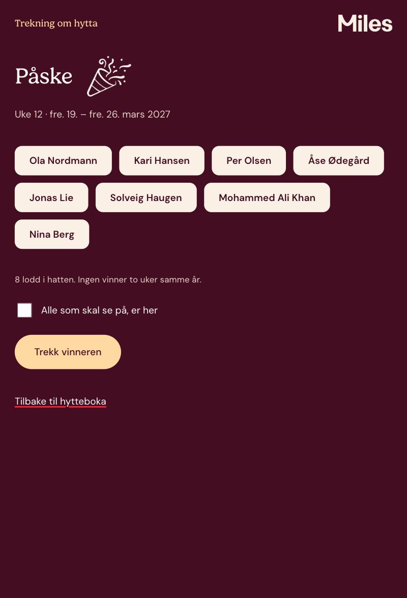
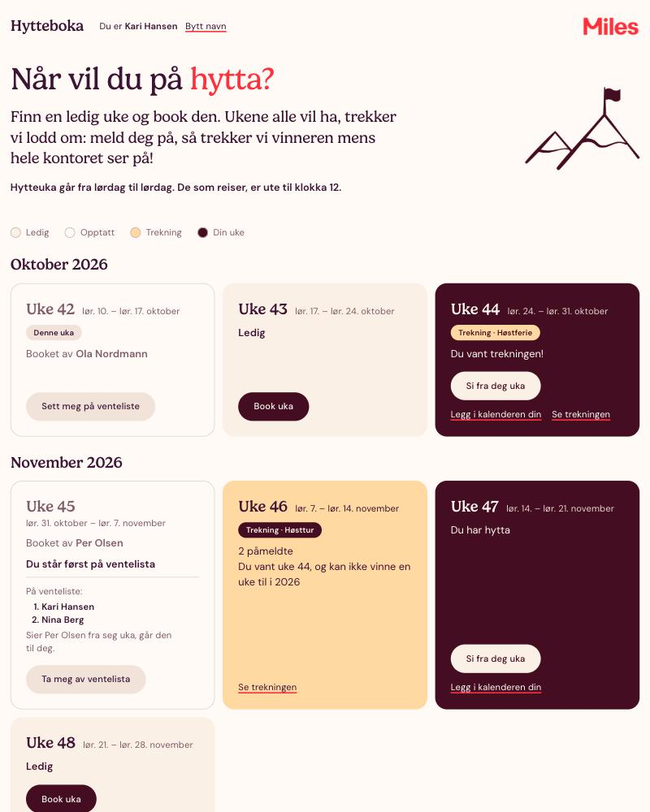
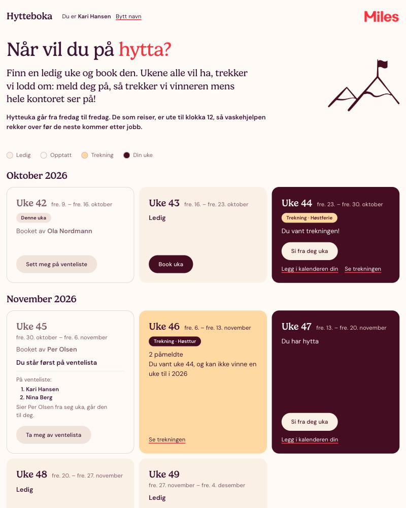
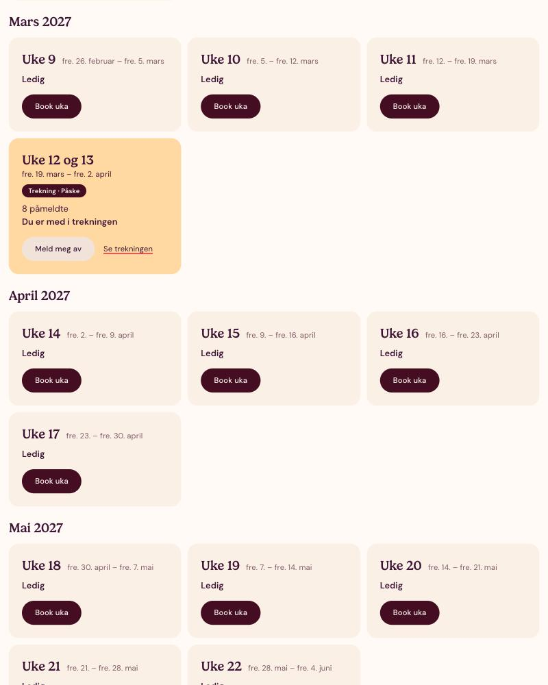

# Historien om Hytteboka

Dette er historien om hvordan Hytteboka ble til, runde for runde: hva kunden sa, hva agenten ble bedt om, hva som kom tilbake, hva vi la merke til, og hva vi gjorde med det.

Hytteboka er en prøvekjøring av øvelsen i Miles-kurset «Agentisk koding». Den ble gjort søndag 11. oktober 2026, tre dager før kurset, for å se om øvelsen holder.

Kunden het Ragnhild da prøvekjøringen ble gjort, og slik står hun her, i meldingene, promptene og commitene. I kurset og i resten av prosjektet heter hun Gro.

## Slik ble prøvekjøringen gjort

- **Kunden er oppdiktet.** Ragnhild er kontorsjef i Havbris AS, og meldingene hennes er skrevet på forhånd som en del av kurset. Hun kommer tilbake med en ny melding i hver leksjon.
- **Henry styrte.** Han satt i én økt i Claude Code og sa hva som skulle prøves.
- **Claude i den økten var orkestrator.** Den skrev promptene under, sendte dem videre, kjørte testene etter hver runde og dyttet til GitHub. Den hadde selv skrevet Ragnhilds meldinger, og kunne derfor ikke bygge uten å jukse.
- **En fersk agent bygget.** Den fikk bare Ragnhilds første melding og rammene, i en tom mappe. Hver ny melding fikk den først når runden før var ferdig. Den visste aldri hva som kom.
- **To agenter til** tok hver sin oppgave i hvert sitt worktree, i runde 6.

Tidene er agentens egne, fra den begynte på en runde til den var ferdig. Antall tester er det orkestratoren fikk da den kjørte `npm test` selv etter runden.

I promptene under er den lange stien til prosjektmappen byttet ut med `<prosjektmappen>`, og Ragnhilds første melding er ikke gjentatt inne i den første prompten. Ellers står de som de ble sendt, skrivefeil og alt.

Bildene i `bilder/historien/` ble tatt til slutt, ett fra hver rundes commit. De har de samme oppdiktede personene, klokka er stilt til onsdag 14. oktober 2026, og siden er sett som Kari Hansen.

## Rundene

| # | Runde | Tid | Tester etterpå | Commit |
| --- | --- | --- | --- | --- |
| 1 | Første utgave | 16 min | 80 | `47b339f` |
| 2 | Lørdag til lørdag | 6 min | 89 | `485baa3` |
| 3 | Byttedagen | 2,5 min | 97 | `9b7b1c4` |
| 4 | Telefonen: ingen vinner to ganger | 6,5 min | 116 | `a3f31d3` |
| 5 | Fredagsoversikten som skill | 4,5 min | 125 | `52cf109` |
| 6 | To ting til fredag, i to worktrees | 18 min side om side | 139 og 148 på hver sin gren | `673f188`, `bba287a` |
| 7 | Sammenslåingen | 17 min | 188 | `5856b78`, `2febaa1`, `29e8a1c` |
| 8 | Miles-profilen | 13 min | 198 | `18e408e` |
| 9 | Fredag til fredag, med grunnen | 6 min | 198 | `34bb2d0` |
| 10 | Påsken som én tur | 11 min | 235 | `31f40e8` |

Til sammen er det rundt en time og førti minutter med agenttid.

---

## 1. Første utgave

**Ragnhild skrev:**

> Hei! Jeg er Ragnhild, kontorsjef i Havbris AS. Vi er førti ansatte og har en firmahytte på fjellet. I dag styrer jeg utlånet i et regneark, og det går ikke lenger. Folk dobbeltbooker, og hver vinter blir det bråk om hvem som får påsken.
>
> Jeg trenger en enkel nettside der de ansatte kan se når hytta er ledig, og booke en uke. De ukene alle vil ha, som påsken og vinterferien, skal det trekkes lodd om: alle som vil ha uka, melder seg på, og så trekker jeg en vinner mens hele kontoret ser på. Det må gjerne være litt stas rundt trekningen.
>
> Kan du ha noe å vise meg i dag?

<details>
<summary>Prompten agenten fikk</summary>

```text
You are a developer who has just received a request from a customer, and you want something to show her today. Build a first version.

Work only inside this empty folder, which is a standalone project of its own:
<prosjektmappen>

It has nothing to do with any repository you may have instructions loaded for (a course platform called Kurs, its AGENTS.md, its conventions, its framework). Ignore all of that; do not read or change anything outside the folder above.

## What the customer wrote

[Ragnhilds melding, som over]

## The frame

- It must run on this machine with one command. No cloud, no login: it is enough that people type their name.
- Use Node.js (v24 is installed) with as few dependencies as you can, ideally none, so it starts at once. Serve it on port 44210.
- She will come back with more requests later. Do not build for requests she has not made.

## How to work

1. You cannot reach her right now. Before you build, write the questions you would have asked her, each with the answer you are assuming, in a file called ANTAKELSER.md.
2. Make a short plan, then build.
3. Prove that it works: automated tests for the logic, and start the server and go through the main flows over HTTP yourself. Stop the server when you are done.
4. Put the project in git with a first commit.

## What to report back

- The stack you chose and the one command that starts it.
- Your list of assumed answers, as written in ANTAKELSER.md.
- How bookings and draws are represented in your data model.
- What the draw does on the page.
- The test results, and what you checked over HTTP.
- Roughly how long the work took you, and anything you were unsure about.

Report what is true, including what does not work yet.
```

</details>

**Det som kom tilbake.** En kalender med 52 uker, booking med navn, og en trekningsside for storskjermen: et lys hopper fra lodd til lodd i sju sekunder og stopper på vinneren, og så faller det konfetti. Alt er skrevet med det som følger med Node 24, uten avhengigheter, og dataene ligger i én JSON-fil. `npm start` starter den.

Agenten skrev ned seksten spørsmål den ville stilt Ragnhild, med svaret den antok for hvert, i [ANTAKELSER.md](ANTAKELSER.md).

**Det vi la merke til.**

- **Det første spørsmålet var hva en uke er.** Den antok mandag til søndag, vanlige ukenumre.
- **Den antok at én person kan vinne flere trekninger.**
- **En booking er lagret per uke**, så en uke kan ikke ha to.
- **Den sa selv hva som var svakt:** hvem som helst kan trykke på trekningsknappen, og den som laster kalenderen på nytt under showet, ser vinneren før den er avslørt.

**Det vi gjorde.** Orkestratoren kjørte testene, så etter at ingenting privat lå i filene, la til en README og publiserte prosjektet. Commitene bærer GitHubs no-reply-adresse i stedet for en jobbadresse.



---

## 2. Lørdag til lørdag

**Ragnhild skrev:**

> Dette ser fint ut! Men hos oss går hytteuka alltid fra lørdag til lørdag, og de som reiser, er ute til klokka tolv. Det trodde jeg alle visste.

<details>
<summary>Prompten agenten fikk</summary>

```text
Ragnhild has seen the first version and written back. Carry on in the same folder.

Since your commit, a README was added as a second commit and the project was pushed to a public GitHub repository. Commit as before; do not push, and leave the git identity as it is now set in the repository.

## What she wrote

"Dette ser fint ut! Men hos oss går hytteuka alltid fra lørdag til lørdag, and de som reiser, er ute til klokka tolv. Det trodde jeg alle visste."

## What to do

1. Say what your version did with weeks, and whether your assumption matched what she now says.
2. Add a CLAUDE.md to the project that holds this rule, so that a later session follows it without being told. Keep the file as small as you can: only what an agent would get wrong without it.
3. Change the app to follow her rule, with tests, and update ANTAKELSER.md where an assumption turned out wrong.
4. Prove it works as before: tests, and the main flows over HTTP. Stop the server afterwards. Commit.

## What to report back

- What changed in the data model and in what people see.
- The full text of CLAUDE.md.
- Test results and what you checked over HTTP.
- Roughly how long it took, and anything you were unsure about.

Do not build for requests she has not made.
```

</details>

**Det som kom tilbake.** Agenten bekreftet at antakelsen var feil: hver dato på sidene var to dager unna. Uka går nå fra lørdag til lørdag og skifter klokka tolv. Det som er lagret, har samme form som før; det er betydningen av en ukenøkkel som er ny. `CLAUDE.md` ble på tre linjer: regelen, hva en ukenøkkel betyr, og hvilken fil som eier regelen.

**Det vi la merke til.**

- **Øvelsen virker.** Regelen er en agenten ikke gjetter, og derfor hører den hjemme i `CLAUDE.md`.
- **Regelen ble lagt i én fil**, `src/weeks.js`. Det kom til nytte i runde 9.
- **Den var usikker på når neste gjeng kan komme.** Ragnhild hadde bare sagt når de som reiser, skal være ute.



---

## 3. Byttedagen

**Ragnhild skrev:**

> Det er noe galt. Når en gjeng reiser lørdag og den neste kommer samme lørdag, sier siden at hytta er opptatt.

<details>
<summary>Prompten agenten fikk</summary>

```text
Ragnhild has reported a problem. Carry on in the same folder; your Saturday commit has been pushed.

## What she wrote

"Det er noe galt. Når en gjeng reiser lørdag og den neste kommer samme lørdag, sier siden at hytta er opptatt."

## What to do

1. Do not change anything yet. First find out whether your version does what she describes: write a test for the Saturday when one group leaves and the next arrives, and look at the page for that day in the browser.
2. If the fault is there, take a picture of the page showing it, fix it, and take a picture of the same page afterwards. Save the pictures in a folder called `bilder/` in the project.
3. If the fault is not there, keep the test as proof, take one picture of the page that shows the changeover day working, and say what she may have seen that looked like it.
4. Commit. Do not push.

## What to report back

- Whether the fault existed in your version, and how you know.
- What the test checks.
- The names of the pictures and what each shows.
- Roughly how long it took.
```

</details>

**Det som kom tilbake.** Feilen fantes ikke. Agenten skrev åtte tester mot appen slik den var, og alle gikk. Så la den inn feilen med vilje, så seks av dem feile, og tok den ut igjen. Den stilte klokka til byttelørdagen klokka halv elleve og gikk gjennom dagen i nettleseren.

Grunnen er datamodellen fra runde 1: en booking er lagret per uke, og uka som slutter en lørdag, er en annen uke enn den som begynner samme dag.

**Det vi la merke til.**

- **Kunden beskriver det hun ser, ikke hvor feilen ligger.** Agenten pekte på hva hun kan ha sett: fram til klokka tolv er kortet merket «Denne uka» gjengen som reiser, og det står «Booket av …» på det. Den som kommer samme dag og leser «Denne uka» som sin, ser en opptatt hytte.
- **Oppgaven i kurset tok for gitt at feilen fantes.** Med «bilde før og etter» er det ingenting å vise når koden er riktig.

**Det vi gjorde.** Oppgaven i leksjonen «Vis, ikke bare fortell» ble skrevet om: først en test og et blikk på siden, så rette det som er galt, enten det er koden eller at siden er uklar.



---

## 4. Telefonen: ingen vinner to ganger

**Ragnhild ringte mens agenten jobbet med runde 3:**

> Jeg glemte å si det: den som vinner en trekning, skal ikke kunne vinne en uke til samme år.

Denne meldingen ble sendt mens agenten holdt på, og lagt i kø til neste steg. Det er det samme som skjer når du trykker `Enter` mens Claude Code jobber.

<details>
<summary>Prompten agenten fikk, i kø</summary>

```text
Ragnhild phones while you are working on the Saturday report. Finish what you are in the middle of, then do this as well.

"Jeg glemte å si det: den som vinner en trekning, skal ikke kunne vinne en uke til samme år."

Add that rule to the draws, with tests, as its own commit after the one for the Saturday report. In your report, add: at what point in your work this message reached you, what you were doing then, how you read "samme år" and what you did where it was unclear, and how long this part took.
```

</details>

**Det som kom tilbake.** Meldingen nådde agenten rett etter første steg i runde 3. Den gjorde ferdig byttedagen til og med commit, og tok så den nye regelen. Når en vinner trekkes, tas loddene hennes ut av årets andre trekninger, og kortet sier «Du vant uke 8, og kan ikke vinne en uke til i 2027».

**Det vi la merke til.**

- **Køen virker som leksjonen sier.** Agenten ble ikke avbrutt, og meldingen ble ikke borte.
- **«Samme år» var ikke entydig.** Agenten leste det som året uka ligger i, ikke året trekningen holdes, og skrev ned hvorfor. Leser en det andre veien, kan noen ta både vinterferien og påsken hvis den ene trekkes før nyttår.
- **Regelen traff**, fordi første utgave hadde antatt det motsatte.



---

## 5. Fredagsoversikten som skill

**Ragnhild skrev:**

> Hver fredag sender jeg ut en oversikt over hvem som har hytta de neste fire ukene. Kan du lage den til meg? Jeg kommer til å be om den hver uke.

<details>
<summary>Prompten agenten fikk</summary>

```text
Ragnhild has a new request. Carry on in the main checkout of the same project; your last two commits are pushed.

Three things have changed around you:
- A copy of the app is running on port 44210 for someone who is looking at it, with made-up people in `data/hytteboka.json`. Do not stop it, do not start anything on 44210, and do not change that data file. Reading it is fine.
- `.gitignore` gained a line for `.claude/worktrees/`, and two other sessions are working there on other requests. Leave those folders and their branches alone.
- Do not push.

## What she wrote

"Hver fredag sender jeg ut en oversikt over hvem som har hytta de neste fire ukene. Kan du lage den til meg? Jeg kommer til å be om den hver uke."

## What to do

Make this a Claude Code skill in the project, in `.claude/skills/<name>/SKILL.md`, so that it can be asked for each week with `/name`, and so that Claude also picks it up when someone asks for the overview in their own words.

- It reads what is in the book now and gives a text in Norwegian that she can paste into an e-mail.
- Choose the frontmatter yourself: the description, and which tools it may use without asking, so that it can run without anyone approving each step.
- Keep `SKILL.md` short.

Commit when it is done.

## What to report back

- The full text of `SKILL.md`, and anything else you added for it.
- Why you chose each frontmatter field and value.
- How you tested it, and what you could not test from where you are.
- Roughly how long it took.
```

</details>

**Det som kom tilbake.** En skill, `/oversikt`, på fem linjer. Den kjører ett lite skript, `overview.js`, som skriver oversikten fra boka. Modellen regner derfor aldri ut en dato selv.

Valgene i frontmatter:

- **`description`** åpner med Ragnhilds egne ord, siden det er slik hun kommer til å spørre.
- **`allowed-tools`** gir lov til akkurat den ene kommandoen, uten jokertegn.
- **`context: fork` er utelatt med vilje.** En subagent ville oppsummert teksten på vei tilbake, og hun trenger den uendret.

**Det vi la merke til.**

- **Selve kallet er uprøvd.** Agenten startet en egen Claude Code-prosess for å skrive `/oversikt`. Den fant skillen og leste frontmatter, og stoppet så med «Not logged in».
- **Oppgaven om `context: fork` har fått et svar:** for denne skillen er fork feil valg, og å se hvorfor er poenget med å prøve.

---

## 6. To ting til fredag, i to worktrees

**Ragnhild skrev:**

> To ting til fredag: en venteliste når uka er tatt, og at folk får bookingen sin inn i kalenderen.

Orkestratoren laget to worktrees av prosjektet, `.claude/worktrees/venteliste` og `.claude/worktrees/kalender`, hver på sin gren. To ferske agenter fikk hver sin oppgave og jobbet samtidig. Promptene var like, bortsett fra hvilken av de to tingene de gjaldt.

<details>
<summary>Prompten agenten med ventelisten fikk</summary>

```text
You are a developer picking up one request from a customer, in an existing small project. Another developer is working on a different request in parallel, in another checkout of the same repository.

Work only inside this folder, which is a git worktree of the project on its own branch, `worktree-venteliste`:
<prosjektmappen>/.claude/worktrees/venteliste

The project is called Hytteboka and has nothing to do with any repository you may have instructions loaded for (a course platform called Kurs, its AGENTS.md, its conventions, its framework). Ignore all of that. Before you start, read this project's own `CLAUDE.md`, `README.md` and `ANTAKELSER.md` in the folder above, and follow them.

## What the customer wrote

Ragnhild, the office manager who ordered the cabin book, wrote: "To ting til fredag: en venteliste når uka er tatt, og at folk får bookingen sin inn i kalenderen."

Your request is the first of the two: **a waiting list when a week is taken.** The other developer has the calendar one. Do not build it.

## Rules

- Change nothing outside the folder above: not the main checkout two levels up, not the other worktree, not the `data/` folder of the main checkout.
- A copy of the app is running on port 44210 for someone who is looking at it. Do not stop it and do not start anything on that port. The tests start their own servers on temporary ports; if you need a running copy of your own, start it on another port and stop it afterwards.
- Add what you had to assume to `ANTAKELSER.md`, as the file already does.
- Commit on your branch. Do not merge, do not push.

## What to report back

- What the waiting list does, for the one who waits and for the one who has the week.
- What you assumed where she did not say.
- Which files you changed, and which parts of them, so that whoever merges the two branches knows where they may collide.
- Test results.
- Roughly how long it took.

Report what is true, including what does not work yet.
```

</details>

Agenten med kalenderen fikk den samme prompten, med grenen `worktree-kalender`, mappen `.claude/worktrees/kalender`, og denne setningen i stedet: «Your request is the second of the two: **that people get their booking into their calendar.** The other developer has the waiting list. Do not build it.»

**Det som kom tilbake.**

- **Ventelisten**, 18 minutter. En tatt uke viser «Sett meg på venteliste». Sier den som har uka, den fra seg, går den rett til den første i køen, som får en melding øverst i kalenderen.
- **Kalenderen**, 10 minutter. Den som har en uke, får lenken «Legg i kalenderen din», som gir en kalenderfil for uka.

**Det vi la merke til.**

- **Side om side tok det 18 minutter.** Etter hverandre hadde det tatt 28.
- **Begge prøvde sammenslåingen i minnet** før de rapporterte, og sa fra om hvor grenene ville kollidere.
- **Kalenderfilen er ikke åpnet i et ekte kalenderprogram.** Den er bare sjekket mot formatets regler i testene.
- **Ingen får beskjed.** Den som får en uke fra ventelisten, ser det først når hun åpner siden.

---

## 7. Sammenslåingen

<details>
<summary>Prompten agenten fikk</summary>

```text
The two other developers have finished Ragnhild's "to ting til fredag", each on its own branch in its own worktree. Get both into `main` and resolve what collides. You are in the main checkout as before.

Since your skill commit, one more commit was added to `main` (the README now names the course) and `main` was pushed. The repository has moved to `miles-no/agentisk-koding-hytteboka`; the remote is already updated. Do not push.

## The branches

- `worktree-kalender`, commit `673f188`: a "Legg i kalenderen din" link that gives a calendar file for a week you have.
- `worktree-venteliste`, commit `bba287a`: a waiting list for a week that is taken, where giving a week up hands it to the first in line.

Both were made from `6ea89f3`. Their authors report these collisions, which you should check for yourself:
- `ANTAKELSER.md`: all three lines of work (yours, and theirs) added numbered items at the same spot.
- `test/app.test.js`: three hunks where each branch appended its own text to neighbouring card assertions.

## What to do

1. Merge both branches into `main` with ordinary merge commits. No rebase, no squash, and leave the two branches as they are.
2. Resolve the conflicts so that everything all three lines of work added is kept, and renumber where numbers collide.
3. Look at where the two features meet, beyond what git flags: someone who gets a week from the waiting list, and the calendar link and file for that week. Fix what does not hold, with a test.
4. Run the tests. The copy on port 44210 is still running for someone who is looking at it: do not stop it, do not start anything on that port, and do not change `data/hytteboka.json`.
5. Commit. Do not remove the worktrees.

## What to report back

- Each conflict git reported, and how you resolved it.
- What you found where the two features meet, and what you did about it.
- Test results.
- Roughly how long it took.
```

</details>

**Det som kom tilbake.** To vanlige merge-commits, og en tredje commit med åtte tester for der de to tingene møtes.

- **`ANTAKELSER.md` kolliderte i begge.** Tre arbeidslinjer hadde nummerert notatene sine fra 22 på samme sted. Alle tre ble beholdt og nummerert om.
- **Testene av ukekortet kolliderte tre steder**, der hver gren hadde lagt til sin egen knappetekst på nabolinjer.
- **Selve koden gikk sammen av seg selv**, selv om begge grenene hadde endret de samme to filene.
- **Der de to tingene møtes, holdt koden.** Den som får en uke fra ventelisten, får kalenderlenken, og filen hennes bærer navnet hennes.

**Det vi la merke til.**

- **Kollisjonen er ekte, men havner i notater og tester.** Det gjør oppgaven «be Claude løse det som kolliderer» til en folk kan bli ferdige med.
- **Agenten fant ting git ikke flagget.** To setninger var ikke sanne lenger, som «en uke noen sier fra seg, er ledig for alle igjen».
- **Agenten oppdaget at kopien på port 44210 var startet på nytt, og at det ikke var den som hadde gjort det.** Det var orkestratoren, på Henrys ønske. Agenten kunne ikke vite det, undersøkte saken og sa fra. En subagent ser like lite av det orkestratoren gjør, som orkestratoren ser av den.



---

## 8. Miles-profilen

**Kunden sa:**

> Kan den se ut som oss?

I kurset er «oss» Miles i denne runden.

<details>
<summary>Prompten agenten fikk</summary>

```text
The merge is pushed. One more request, and for this one the customer is Miles, the Norwegian technology consultancy: the cabin book is to be shown at Miles, so "us" means Miles.

About the copy on port 44210: it was restarted by the session you report to, so that the person looking at it sees the merged app. Nothing is wrong there. It is still running: do not stop it, do not start anything on that port, and do not change `data/hytteboka.json`.

## What the customer said

"Kan den se ut som oss?"

## What to do

1. Before you change anything, take pictures of the calendar page and a draw page as they look now, on a copy of your own with made-up people.
2. Give Hytteboka Miles' look and voice. Find out for yourself where Miles' brand rules are to be had on this machine, and follow them.
3. Take pictures of the same two pages afterwards. Save all four in `bilder/`.
4. Keep what goes into the repository small, since it is public: only the brand files the pages actually use, such as a logo and the icons or illustrations you place, and no font files. Follow whatever the brand rules themselves say about fonts and licences.
5. Tests, then commit. Do not push.

## What to report back

- How you found the brand rules, and which of their files you read.
- What you changed in how the pages look and read, and what you chose not to change.
- Which brand files you copied into the repository, and how the fonts load.
- The names of the four pictures.
- Anything in the brand rules you could not follow here, and why.
- Test results, and roughly how long it took.
```

</details>

**Det som kom tilbake.** Agenten fant skillen `miles-brand` selv, uten at prompten nevnte den, og leste det skillen viste den til. Sidene fikk kremfargede kort, burgunder knapper, Gelica i overskriftene, Miles-logoen oppe til høyre og Miles' egne tegninger. Teksten ble skrevet som «vi» til «du». Sju merkevarefiler ligger i `public/brand/`, og ingen skriftfiler.

**Det vi la merke til.**

- **Beskrivelsen i skillen var nok.** «Kan den se ut som oss?» og «oss er Miles» holdt for at agenten skulle finne den.
- **I ti minutter endret den ingen fil i prosjektet.** Den jobbet i et worktree av sitt eget. Orkestratoren kunne ikke se forskjell på det og en agent som sto fast.
- **Noen regler kunne den ikke følge.** Temaets røde knapper med liten lys tekst bryter merkevarens egen kontrastregel, så knappene ble burgunder. Det står som et åpent spørsmål i merkevaren selv.
- **Bildene «etter» er sider tegnet med Gelica**, i et åpent repo. Merkevaren sier at det er uavklart om det teller som bruk på nett under lisensen.

**Det vi gjorde.** Punktet om at hovedagenten ikke ser inn i en subagent mens den jobber, ble lagt til i leksjonen «Agenter og subagenter». Repoet ble flyttet til `miles-no`, siden det nå bærer Miles' profil.

| Før | Etter |
| --- | --- |
|  |  |



---

## 9. Fredag til fredag, med grunnen

Mens runde 8 gikk, spurte Henry hvorfor uka gikk fra lørdag til lørdag. Svaret var at orkestratoren hadde valgt det da den skrev Ragnhilds meldinger, fordi det måtte være en regel agenten gjetter feil på. Henry mente fredag til fredag ga mer mening, og at grunnen til et slikt valg måtte komme godt fram i oppgaven.

**Ragnhild rettet seg selv:**

> Beklager, jeg sa feil sist: hytteuka går fra fredag til fredag, ikke lørdag. De som reiser, er fortsatt ute til klokka tolv.

**Og ga grunnen:**

> Da får de som kommer, hele helga på fjellet, og de som reiser, har helga hjemme. De som reiser, er ute til klokka tolv, så vaskehjelpen rekker over før neste gjeng kommer etter jobb.

Begge meldingene ble lagt i kø mens agenten jobbet med Miles-profilen.

<details>
<summary>De to promptene agenten fikk, i kø</summary>

```text
Ragnhild has corrected herself. Finish the Miles look first, through its commit, then do this as its own commit after it.

"Beklager, jeg sa feil sist: hytteuka går fra fredag til fredag, ikke lørdag. De som reiser, er fortsatt ute til klokka tolv."

Change the rule everywhere it lives: the app, the tests, `CLAUDE.md`, `ANTAKELSER.md`, the Friday overview and its skill, the calendar file, and any text on the pages. Say in `ANTAKELSER.md` that she first said Saturday. Pictures already in `bilder/` that show Saturday weeks are history; leave them, or say in your report if one should be retaken.

The copy on port 44210 is still running for someone looking at it: as before, do not stop it, do not use that port, and do not change `data/hytteboka.json`. Do not push.

In your report, add for this part: what had to change and where, whether keeping the rule in one file held up, the test results, and how long it took.
```

```text
An addition to Ragnhild's correction about Friday to Friday, for when you get to it. She also gave her reason, and it belongs with the rule:

"Da får de som kommer, hele helga på fjellet, og de som reiser, har helga hjemme. De som reiser, er ute til klokka tolv, så vaskehjelpen rekker over før neste gjeng kommer etter jobb."

Put the reason in `CLAUDE.md` beside the rule, still keeping the file small, and let it settle what you were unsure about earlier: when the next group may arrive. Say on the page what people need to know from it, and say in your report what the reason let you decide that the bare rule did not.
```

</details>

**Det som kom tilbake.** Uka går nå fra fredag til fredag. `CLAUDE.md` har regelen med grunnen, og siden sier: «Hytteuka går fra fredag til fredag. De som reiser, er ute til klokka 12, så vaskehjelpen rekker over før de neste kommer etter jobb.»

**Det vi la merke til.**

- **Grunnen avgjorde noe regelen ikke sa.** Med bare regelen hadde agenten antatt at neste gjeng kunne komme klokka tolv, og kalenderfilen startet oppholdet da. «Etter jobb» sa noe annet, og filen starter nå klokka 16.
- **Å ha regelen i én fil holdt halvveis.** For dagene holdt det: én konstant flyttet alt. For ordene holdt det ikke: setningen «fra lørdag til lørdag» sto skrevet i tre filer. Den ligger i én nå.
- **Påsken deler seg** når uka skifter på en fredag. Det ble runde 10.

**Det vi gjorde.** Leksjonen «Kontekst og CLAUDE.md» fikk Ragnhilds melding med grunnen, og oppgaven sier at regelen skal skrives inn i `CLAUDE.md` med grunnen. Etterpå tok agenten de to «etter»-bildene på nytt og gjorde README sann igjen, siden sidene nå henter to skrifter utenfra.

<details>
<summary>Prompten for bildene og README</summary>

```text
Both commits are pushed, and the copy on 44210 has been restarted by the session you report to, so it now serves the Miles look with Friday weeks. The two merged worktrees are removed; their branches remain.

Two small things to finish, as one commit. As before: do not stop the copy on 44210 or use its port, do not change `data/hytteboka.json`, and do not push.

1. Retake `bilder/miles-etter-kalenderen.jpg` and `bilder/miles-etter-trekningen.jpg` so they show the pages as they are now, with Friday weeks, using the same made-up people and the same view as the two "for" pictures.
2. The README says the app runs "uten sky", while the pages now fetch two stylesheets for fonts from outside. Make the README true, in one or two sentences, and bring anything else in it that is no longer true up to date (the look is Miles', the week runs Friday to Friday).

Report back in a few lines: what the two new pictures show, what you changed in the README, and the test result.
```

</details>



---

## 10. Påsken som én tur

**Ragnhild skrev:**

> Påsken ble feil. Den som vinner, må ut langfredag klokka tolv, midt i påsken! Hos oss er påsken én tur: fra fredagen før palmesøndag til fredagen etter andre påskedag, og én vinner får hele. Ingen reiser på fjellet for en halv påske.

<details>
<summary>Prompten agenten fikk</summary>

```text
Your last commit is pushed. Ragnhild has one more thing, about Easter.

## What she wrote

"Påsken ble feil. Den som vinner, må ut langfredag klokka tolv, midt i påsken! Hos oss er påsken én tur: fra fredagen før palmesøndag til fredagen etter andre påskedag, og én vinner får hele. Ingen reiser på fjellet for en halv påske."

## What I am asking for

- **Today:** the Easter draw that the book starts with is one cabin week. In 2027 that is `2027-W12`, Friday 19 March to Friday 26 March, so the winner is out at twelve on Good Friday, and Easter Saturday to Easter Monday lie in the next week, which is an ordinary first-come week.
- **What should happen:** Easter is drawn as one trip of two cabin weeks, from the Friday before Palm Sunday to the Friday after Easter Monday. One draw, one winner, and the winner has the cabin for the whole of it. In 2027 that is Friday 19 March to Friday 2 April.
- **Why:** nobody goes to the mountains for half an Easter. The reason is hers; use it where the rule does not say what to do.
- **Done when:** the calendar, the draw page and the manager's page show Easter as one trip with its two Fridays; drawing it gives one person both weeks; a book written before this change still reads; and the tests say so.
- **Keep it small:** this is about Easter. Do not rebuild how other draws work beyond what this needs.

She has not said what this means for the rest of what a week can do: winning only once a year, the waiting list, the calendar file, the Friday overview, and giving the trip up. Decide each by her reason, and write the decisions down in `ANTAKELSER.md`.

As before: the copy on port 44210 is running for someone who is looking at it. Do not stop it or use its port, and do not change `data/hytteboka.json`; its book has an Easter draw with people entered, which is the old-book case to keep working. Take one picture of the Easter draw page afterwards for `bilder/`. Commit, and do not push.

## What to report back

- What changed in the data model and on the pages.
- Each thing she did not say, and what you decided for it.
- What happens to the people already entered in the old Easter draw.
- Whether the rule files (`CLAUDE.md`, `src/weeks.js`) needed to change, and how.
- Test results, the picture's name, and roughly how long it took.
```

</details>

**Det som kom tilbake.** Påsken trekkes som én tur på to hytteuker, med én vinner. I 2027 er det fredag 19. mars til fredag 2. april. Ingenting nytt er lagret: en trekning på påskens første uke står nå for den uka og den neste, og én funksjon svarer på hvem som har en uke.

Det Ragnhild ikke hadde sagt, avgjorde agenten ut fra grunnen hennes:

| Hun sa ikke | Avgjørelsen |
| --- | --- |
| Vinne én gang i året | Påsken er én seier. Vinneren kan ikke vinne vinterferien samme år. |
| Venteliste | Ingen, som for andre trekninger. |
| Si fra seg turen | Hele eller ingenting. Da trekkes den på nytt blant de andre. |
| Kalenderfilen | Én hendelse, fra fredag klokka 16 til fredag klokka 12 to uker etter. |
| Fredagsoversikten | Én linje med begge fredagene. |
| Langfredag | Ikke noe bytte. Vinneren blir. |
| De som alt var påmeldt | De er med i trekningen om hele turen, uten å melde seg på igjen. |

**Det vi la merke til.**

- **Denne prompten var en ferdig bestilling.** Den sa hva som skjer i dag, hva som skal skje, hvorfor, og når det er ferdig. Agenten leverte, og avgjorde resten selv.
- **Etterpå sa Henry at det ikke er dette kurset skal lære bort.** Det som bør komme først, er å snakke med agenten om problemet før den bygger. Da hadde «det hun ikke sa» kommet opp i samtalen i stedet for i en tabell etterpå.

**Det vi gjorde.** Leksjonen «Prompting» fikk et nytt første tips, «Snakk om problemet før du ber om en løsning», og påskeoppgaven der begynner nå med å lime inn meldingen hennes og si at ingenting skal bygges ennå.



---

## Hva prøvekjøringen endret i kurset

- **Byttedagen.** Oppgaven tar ikke lenger for gitt at feilen ligger i koden.
- **Subagenter.** Leksjonen sier nå at hovedagenten ikke ser inn i en subagent mens den jobber, og at du selv kan gjøre det med `/tasks`.
- **Regelen med grunnen.** Uka går fra fredag til fredag, og Ragnhild sier hvorfor. Grunnen skal med i `CLAUDE.md`.
- **Snakk først.** Oppgavene går nå samtale først, så klarsignal. Planmodus anbefales ikke; «ikke bygg noe ennå» holder.
- **Påsken** er blitt Ragnhilds melding i leksjonen om prompting.

## Det som står åpent

- **`/oversikt` er aldri kalt** i en innlogget økt. Om den kjører uten å spørre om lov, er uprøvd.
- **Kalenderfilen** er ikke åpnet i Outlook, Google Kalender eller Apples Kalender.
- **Bildene med Gelica** kan måtte ut, om merkevaren sier det.
- **Uten innlogging** kan hvem som helst skrive hvilket som helst navn, trykke på trekningsknappen og melde andre av. Det følger av rammene, og er det første en ekte kunde måtte tatt stilling til.
- **En trekning som åpnes igjen** kan liste noen som siden har vunnet en annen samme år. De holdes utenfor når det trekkes, men står på siden.
